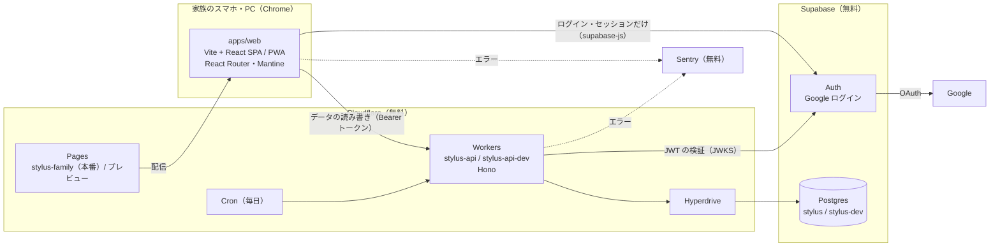

# アーキテクチャ

> システムの全体構成と、レイヤーごとの責務。実装がこれとずれたら、どちらを直すかを決めて揃える。
> 技術判断の理由は adr/ に書く。

updated: 2026-09-29

## 全体構成

フロント（SPA・PWA）とバックエンド（API）を完全に分ける。フロントは Supabase をログイン・ログアウト・セッション管理にだけ使い、データの読み書きはすべて API を通す。すべて無料の範囲で動かす。



### 環境

| 環境 | フロント | API | DB・Auth | どこから作られるか |
|---|---|---|---|---|
| 本番 | Pages の本番（`https://stylus-family.pages.dev`） | `stylus-api` | Supabase `stylus` | `main` |
| 開発 | Pages のプレビュー（`develop` と `spec/*` の各ブランチ） | `stylus-api-dev` | Supabase `stylus-dev` | `develop`（API）、各ブランチ（フロント） |
| ローカル | `http://localhost:5173`（Vite の開発サーバー） | `wrangler dev --env dev` | Supabase `stylus-dev` | 手元 |

- フロントの接続先（Supabase の URL・公開キー・API の URL・Sentry の DSN）は、Pages の環境変数を「本番」と「プレビュー」で分けて渡す。Sentry の environment は、Pages のビルドのブランチ名で決める（`main` なら `production`、それ以外は `development`）
- API の設定は `apps/api/wrangler.toml` の本番と `[env.dev]` で分ける（CORS で許可するオリジン、Supabase の URL、Sentry の environment、Hyperdrive）

### リポジトリ構成

```
apps/
  web/          Vite + React（TypeScript）。ルーティングは React Router、見た目は Mantine、PWA は vite-plugin-pwa
  api/          Hono（TypeScript）。wrangler.toml に本番と [env.dev]。マイグレーションは drizzle/
packages/
  shared/       フロントと API で共有する型・Zod スキーマ・ルール（日本時間の日付など）。@stylus/shared
  repo-checks/  リポジトリ全体の検査だけを持つテスト用パッケージ（秘密情報・import の境界の lint ルール）
.github/workflows/
  ci.yml          develop・main への PR ごとに lint・型検査・テスト・フロントのビルドとビルド成果物の検査
  deploy-api.yml  マイグレーション → wrangler deploy（develop → 開発、main → 本番、手動実行は開発だけ）
```

## レイヤーと責務

| レイヤー | 責務 | 置き場所 | やってはいけないこと |
|---------|------|---------|------------------|
| 画面 | 画面の振り分け（ログイン状態の見張り）、表示、操作。通信できない・読み込めないときの表示 | `apps/web/src/pages`、`components`、`router.tsx` | 認可の判断（ボタンの出し分けは見た目のためだけ）。データを Supabase から直接読み書きする |
| ログイン状態 | supabase-js のセッションを画面に伝える。ログイン・ログアウト | `apps/web/src/auth` | セッションを消すのは、ログアウト・Supabase が無効と返したとき・API が 403 `not_a_member` を返したときだけ。それ以外（通信エラー・500）では消さない |
| API の呼び出し | Hono RPC（`hc<AppType>`）で API を呼ぶ。アクセストークンを `Authorization: Bearer` で付け、401 なら1回だけ更新して送り直す | `apps/web/src/api` | Cookie を使う。`apps/api` の実行コードを import する（`import type` だけ許す） |
| API の共通処理 | CORS → エラー処理（500 と Sentry）→ トークンの検証 → DB を開く → 家族の照合 の順のミドルウェア | `apps/api/src/middleware` | 順番を崩す（トークンが無効な要求で DB を開かない） |
| API のルート | 各機能の処理。ロール・立場が要る操作は `requireAdmin()`・`requireAttribute()` を付ける | `apps/api/src/routes` | 重い処理をする（1要求の CPU 時間は 10ms が目安） |
| DB | Drizzle のスキーマとマイグレーション。要求ごとに Hyperdrive 経由で接続して閉じる | `apps/api/src/db`、`apps/api/drizzle` | RLS を有効にしないテーブルを作る。ポリシーを作る（Data API から読み書きさせない） |
| 共有 | 型・Zod スキーマ・共通のルール（日本時間の日付） | `packages/shared` | どちらかの実行環境に依存するコードを置く |

## データの流れ

自分の情報を出す（`GET /me`）の例。各機能も同じ道を通る。

1. 画面が `api.me.$get()` を呼ぶ。API の呼び出しが supabase-js からアクセストークンを取り（期限が近ければ supabase-js が更新する）、`Authorization: Bearer` で送る
2. API は CORS を確かめ、トークンを Supabase の JWKS の公開鍵で検証する（ES256、発行元と宛先も確かめる）。無効なら 401
3. Hyperdrive 経由で DB を開き、トークンの `sub` で `members.auth_user_id` を探す。見つからなければ 403 `not_a_member`
4. ルートが応答を返す（`{ id, displayName, isAdmin, isParent, isCook }`）。応答の後に DB を閉じる
5. 画面は 401 なら1回だけ更新して送り直し、403 なら未登録として端末のセッションを消してログイン画面へ、通信エラーなら「通信できません。…」、それ以外の失敗なら「うまく読み込めませんでした。…」を出す

## 外部サービス

| サービス | 用途 | 失敗したときの扱い |
|---------|------|----------------|
| Supabase Auth | Google ログイン、セッション、JWT の発行（JWKS） | ログインの失敗は「ログインできませんでした。…」。更新が通信エラーならセッションを残して「通信できません。…」。JWKS に届かなければ API は 500 |
| Supabase Postgres（Hyperdrive 経由） | アプリのデータ | API は 500 `internal` を返し、Sentry に送る。画面は「うまく読み込めませんでした。…」 |
| Cloudflare Pages | フロントの配信（Git 連携で自動デプロイ） | Service Worker が画面を端末に保存しているので、配信が止まっても開ける |
| Cloudflare Workers・Cron | API と、毎日1回の Supabase への問い合わせ（休止を防ぐ） | Cron が失敗したら Sentry に送る。翌日の実行で取り返せるので、その場で再試行はしない |
| Sentry | API とフロントの予期しないエラーの記録 | 送れなくてもアプリの動作は止めない |
| Google | OAuth（ログイン） | Supabase Auth の失敗と同じ扱い |
| GitHub Actions | PR の検査、マイグレーションと API のデプロイ | 失敗した PR はマージしない（ブランチ保護が使えないため運用で守る） |

## 規約

- エラーの応答の形は `{ error: { code, message } }`。401 `unauthenticated`、403 `not_a_member` / `forbidden`、500 `internal`
- 日付は日本時間（UTC+9）の0時で区切る。求め方は `@stylus/shared` の `toJstDate()` 1つにまとめる。Workers の Cron は UTC で動く
- 秘密情報（サービスロールキー、DB の接続情報、Cloudflare の API トークン）は Workers の secret と GitHub の Environments の secret にだけ置く。フロントに置くのは公開してよい値（Supabase の URL と公開キー、API の URL、Sentry の DSN）だけ
- 新しい依存パッケージを API に足すときは、Workers で動くかを確かめる
- マイグレーションは API より先に流れ、フロントは別に配信される。列の削除や名前の変更は2回に分けて行う
- 押せる部分は 44×44px 以上。ボタンの標準の大きさは Mantine のテーマで `lg`（高さ 50px）にしてある
- ブランチ運用：`main`＝本番、`develop`＝開発の統合先（既定ブランチ）、`spec/NNN-<name>` で作業。spec → develop は squash、develop → main はマージコミット。rebase は使わない

## 運用

### 家族の登録の仕方

1. Supabase の Auth の管理画面（Authentication → Users → Add user → Create new user）で、家族のメールアドレスの利用者を作る。**Auto Confirm User** に印を付ける（メールを送らない）。パスワードは使わない（Google ログインだけ）
2. SQL エディタで `members` に表示名・立場・ロールを入れる。`auth_user_id` には `auth.users` からそのメールアドレスの利用者 ID を引いて入れる（1文の `INSERT … SELECT` に `RETURNING id, email, auth_user_id` を付ける）
   ```sql
   insert into public.members (auth_user_id, email, display_name, is_admin, is_parent, is_cook)
   select id, lower(email), '＜表示名＞', false, true, false
   from auth.users
   where email = lower('＜メールアドレス＞')
   returning id, email, auth_user_id;
   ```
3. メールアドレスを打ち間違えると0件のまま成功扱いで終わるので、1人ごとに結果が1行表示されることを確かめる
4. 最後に `members` を SELECT して、人数がそろい、全員の `auth_user_id` が埋まっていることを確かめる
5. Google の OAuth の同意画面を「テスト中」のまま使っている間は、その人の Google アカウントを OAuth のテストユーザーにも足す

登録する値（2026-09-27 時点）：せいご＝管理者、父・母＝親、母＝料理担当

### 定期的に確かめること

- 開発・本番の Cron が毎日成功していること（Cloudflare の Workers のダッシュボード、または GraphQL の `workersInvocationsScheduled`）と、Supabase が休止していないこと
- 本番に出すときと機能を足すたびに、Workers のダッシュボードで CPU の上限を超えたエラー（1102）が出ていないこと。起動直後の要求は 10ms を超えることがある（docs/review-notes.md）
- 本番・開発に出すときに、公開キーで Data API を呼んでアプリのデータを読めない・書けないこと
