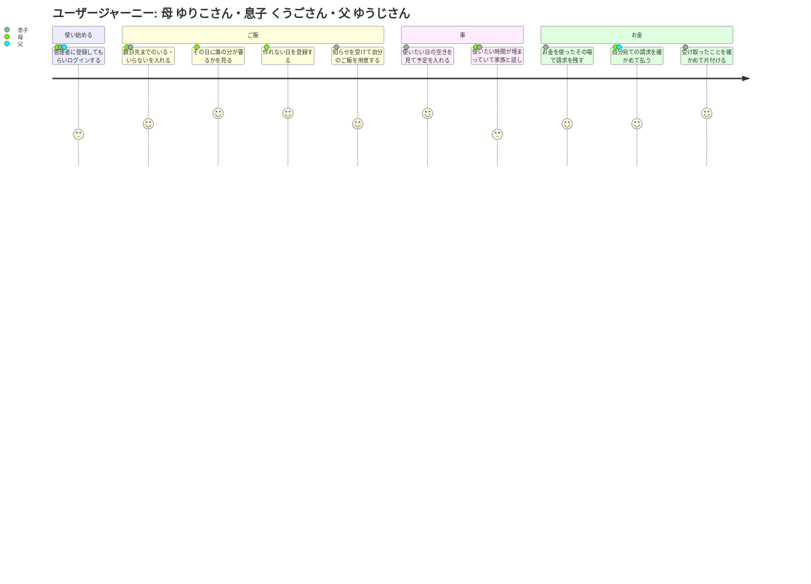

# プロダクトビジョン: Stylus

> 要求（Why）の常設文書。プロダクト全体について「誰の・どんな課題を・なぜ解決するか」を定義する。
> 要件は requirements/、変更ごとの差分は specs/ に書く。この文書には機能・データ・画面を書かない。

updated: 2026-10-04

## 1. 背景・課題

### 背景

父・母・息子2人の4人家族。父は海外に単身赴任中で、普段家にいるのは母と息子2人。ご飯は基本的に母が作り、車1台を母と息子2人で共有している。家族の間では、誰かが立て替えたお金や、医療費など親が補助する分のお金のやり取りがある（単身赴任中の父に請求することもある）。親が補助する分は「家庭」宛てに請求する。「家庭」宛ては、親（父・母のどちらか）が対応する請求先を指す。逆に、家庭で立て替えた息子の分などを、親が「家庭」として息子に請求することもある。

ご飯を作れない日・ご飯のいる・いらない・車を使う予定の連絡は、LINE・口頭・その場の早い者勝ちで回っている。お金は何か月かに一度、各自が使用履歴を見返してまとめて精算している。そのため、連絡が遅れて届いたり、記録が残らなかったりする。

息子の一人（せいご）が、こうした連絡と請求をまとめる家族専用のアプリに需要があるかを家族に聞いたところ、ほしいという答えだった。そこで、せいごが管理者となって作ることになった。

### 現状

| 領域 | いまの回し方 | そのやり方で起きていること |
|---|---|---|
| ご飯を作れない日 | 母が作れない日は、LINE か口頭で息子に1人ずつ伝える | 母は毎回伝えて回るのが面倒。息子は直前に知ることが多く、自分のご飯を急いで用意することになる |
| ご飯のいる・いらない | 息子が口頭か LINE で母に伝える | 伝えるのが遅れることがある。母は直前になって「要らない」「やっぱり要る」が分かり、準備の計画が立てられない |
| 車 | 決まった伝え方は無く、先に使った人が乗っていく | いつ・誰が・何時まで使っているか分からない。使おうとしたら先に乗っていかれていることがある。少し先の日に使いたくても前もって伝える手段が無い |
| お金 | 何か月かに一度、個別に精算する。各自が使用履歴から請求するものを書き出して計算する | 書き出しが面倒で精算の回数が減り、1回で大きな額が動く。請求漏れが起きる。普段はいくら請求がたまっているか分からない。払った・もらっていないの行き違いが起きる |

父は単身赴任中のため、ご飯と車には基本的に関わらない（単身赴任中は車を使わない）。お金の請求には関わる。一時帰国しているあいだは、ほかの家族と同じように、自分のご飯のいる・いらないや車の予定を入れる（特別な扱いはしない）。

この文書でいう「作れない日」は、日付と朝・昼・夕ごとの「作れない食事」を指す。

### 課題一覧

| ID | 課題 | 困っている人 | 影響度 | 優先度 |
|----|------|------------|--------|--------|
| P-1 | ご飯を作れない日を、息子一人ひとりに伝えて回るのが面倒 | 料理担当（母） | 中 | 高 |
| P-2 | ご飯を作れないことを直前に知るため、自分のご飯を急いで用意しなければならない | 息子 | 高 | 高 |
| P-3 | ご飯のいる・いらないの連絡が遅れ、準備の計画が立てられない | 料理担当（母） | 高 | 高 |
| P-4 | 車をいつ・誰が・何時まで使っているか分からず、使おうとしたら先に乗っていかれていることがある | 車を使う人（母・息子） | 高 | 高 |
| P-5 | 少し先の日に車を使いたくても、前もって家族に伝える手段が無い | 車を使う人（母・息子） | 中 | 高 |
| P-6 | 精算のたびに大量の使用履歴から請求するものを書き出すのが面倒。そのため精算の回数が減り、1回で大きな額が動く | 請求する人 | 中 | 中 |
| P-7 | 請求すべきものを見落とす（請求漏れ） | 請求する人 | 高 | 中 |
| P-8 | 普段の生活の中で、請求できる・されるお金がいくらたまっているか分からない | 請求する人・請求される人 | 低 | 中 |
| P-9 | 請求したか・払ったかの認識が食い違い、「払った」「もらっていない」の行き違いが起きる | 請求する人・請求される人 | 中 | 中 |
| P-10 | まとめて届いた請求が、何の分でいくらかを確かめるのに手間がかかる | 請求される人 | 中 | 中 |

## 2. ゴール

「ビジネス」は、作って運用する側（管理者）と家族全体から見たゴールを指す。

| ID | 種別 | ゴール | 解決する課題 |
|----|------|-------|------------|
| G-1 | ビジネス | ご飯・車・お金の連絡と記録が家族専用のアプリ1つに集まり、LINE・口頭での個別連絡に頼らなくて済む | P-1, P-3, P-5, P-9 |
| G-2 | ユーザー | 料理担当は、作れない日を一度登録するだけで家族全員に伝えられる | P-1 |
| G-3 | ユーザー | 息子は、作れない日を登録された時点で知り、自分のご飯を前もって用意できる | P-2 |
| G-4 | ユーザー | 料理担当は、朝・昼・夕ごとに誰の分が要るかを前もって分かり、準備の計画を立てられる | P-3 |
| G-5 | ユーザー | 車を使う人は、いつ・誰が・何時まで使うかが分かり、先の予定も前もって押さえられる | P-4, P-5 |
| G-6 | ユーザー | 請求する人は、お金を使ったときにその場で請求を残せる。精算のときに使用履歴を見返さずに済み、請求漏れが無くなる | P-6, P-7 |
| G-7 | ユーザー | 家族それぞれが、自分が請求している・されている金額と、払ったかどうかを、いつでも同じ記録で確かめられる | P-8, P-9, P-10 |

### 成功指標

| 指標 | 目標値 | 測定方法 | 対応するゴール |
|------|--------|---------|--------------|
| 作れない日を個別に伝える連絡 | LINE・口頭で一人ひとりに伝える連絡が無くなる | 運用で目視（母に聞く） | G-1, G-2 |
| 作れない日を息子が知るタイミング | 直前に知ることが無くなる | 運用で目視（息子に聞く） | G-3 |
| いる・いらないの入力 | 母と息子2人が前もって入力し、母が直前に知ることが減る | 運用で目視（母に聞く） | G-4 |
| 車の鉢合わせ | 使おうとしたら先に乗っていかれていた、が無くなる | 運用で目視 | G-5 |
| 精算のときの書き出し | 精算のときに使用履歴を見返して書き出す作業が無くなる（アプリの記録を見れば精算する額が分かる）。何か月かに一度まとめて精算するやり方は残ってよい | 運用で目視 | G-6 |
| 行き違い | 払った・もらっていないで揉めることが無くなる | 運用で目視 | G-7 |
| 使い続けられているか | 3か月後も、家族が LINE・口頭のやり方に戻っていない | 運用で目視 | G-1 |

## 3. 非目標

先送りしているだけのもの（後回し）はここに書かない。ここにあるのは「やらない」と決めたものだけ。

| やらないこと | 理由 |
|------------|------|
| お金を実際にやり取りする（決済） | アプリは記録だけを扱う。支払いは手渡しや送金アプリなど、アプリの外で行う |
| レシート・領収書の画像を残す | 誰も面倒がってやらないため |
| 来客の分のご飯を扱う | 来客はめったに無く、そのときは口頭で伝えれば足りるため |
| 車の予定の調整（取り合いの解決） | 調整は家族が話し合って行う。アプリは先に入れた予定を記録するだけ |
| 家族の役割（権限・立場）をアプリ上で変える | 4人固定で、変わることがほとんど無いため |
| 請求で「かかった額」と「請求額」を分けて扱う | 補助の範囲は、請求する側が考えて金額を決めるため |
| アプリストアで配布する | 登録に費用がかかり、完全無料の方針に反するため |
| 費用がかかる作り方・運用をする | 完全無料の範囲で作り、運用する方針のため |
| 家族以外が使う（一般公開、ほかの家庭への提供） | 自分の家族4人のためのアプリのため |
| 献立・レシピ・買い物リストを管理する | 困りごとは「作れない日」と「誰の分が要るか」の連絡で、献立ではないため |
| 家計簿（家族の収支全体）をつける | 困りごとは家族の間の請求で、家計全体の管理ではないため |

## 4. ペルソナ

別々の望みを持つ3人を立てる。息子2人は望みが同じなので1人にまとめる。

### 母（料理担当）

| 項目 | 内容 |
|------|------|
| 名前 | ゆりこさん |
| 年齢 | 57歳 |
| 職業 | パート勤務 |
| 家での役割 | 料理担当。親（「家庭」宛ての請求に対応し、「家庭」として請求することもある） |
| 技術スキル | スマホの操作に慣れている。深い知識が要る扱いはできない |

**目標・ゴール**

- 作れない日を、一度で家族全員に伝えたい
- 誰の分のご飯が要るかを前もって知り、準備の計画を立てたい
- 車を使いたいときに、使えるかどうかをすぐ確かめ、自分が使う予定も入れておきたい
- 自分宛て・「家庭」宛ての請求を確かめて払い、行き違いを無くしたい
- 家庭で立て替えた息子の分を、「家庭」として請求しておきたい

**課題（ペインポイント）**

- 作れない日を、息子一人ひとりに伝えて回るのが面倒（P-1）
- 直前になって要る・要らないが分かり、計画が立てられない（P-3）
- 車を使おうとしたら、先に乗っていかれていることがある。少し先の予定を前もって伝える手段が無い（P-4, P-5）
- 払った・もらっていないの行き違いが起きる（P-9）

**利用状況**

| 利用場面 | 頻度 | 詳細 |
|---------|------|------|
| ご飯の準備の計画 | 毎日 | 朝・昼・夕ごとに、誰の分を作るかを確かめる |
| 自分のいる・いらないの連絡 | 予定が分かったとき | 外で食べるなど、自分の分が要らない食事を伝える |
| 車を使えるかの確認と予約 | 毎日 | 使いたい時間に、ほかの家族の予定が入っていないかを確かめ、使うときは自分の予定を入れる |
| 作れない日の連絡 | 作れない日が決まったとき | 作れない食事を家族に伝える |
| 請求の確認と支払い | 請求が来たとき | 息子からの補助の請求（「家庭」宛て）などを確かめて払う |
| 「家庭」としての請求 | 家庭で立て替えたとき | 家庭で立て替えた息子の分などを、「家庭」として息子に請求する |

### 息子

| 項目 | 内容 |
|------|------|
| 名前 | くうごさん |
| 年齢 | 19歳 |
| 職業 | 大学生 |
| 家での役割 | ご飯を食べる側。車を使う。主に請求する側 |
| 技術スキル | 使いこなせる。プログラムの知識もある |

**目標・ゴール**

- ご飯を作ってもらえない日を早めに知り、自分のご飯を前もって用意したい
- いる・いらないを、思いついたときに先の分までまとめて伝えたい
- 車を使いたい日を前もって押さえ、使おうとしたときに乗れる状態にしたい
- お金を使ったときに請求を残しておき、精算で履歴を見返す手間と請求漏れを無くしたい
- 「家庭」から来た請求を確かめて払いたい

**課題（ペインポイント）**

- 作れないことを直前に知り、自分のご飯を急いで用意しなければならない（P-2）
- いる・いらないを伝えるのが遅くなってしまう（P-3。困るのは母だが、原因は息子側にある）
- 車を使おうとしたら先に乗っていかれている。少し先の予定を前もって伝える手段が無い（P-4, P-5）
- 精算のたびに使用履歴から書き出すのが面倒で、見落としも出る。いくらたまっているか分からない（P-6, P-7, P-8）
- 払った・もらっていないの行き違いが起きる（P-9）

**利用状況**

| 利用場面 | 頻度 | 詳細 |
|---------|------|------|
| ご飯の準備が要るかの確認 | 毎日 | 作ってもらえない食事が無いかを確かめる |
| いる・いらないの連絡 | 毎日 | 自分の分が要るかどうかを伝える |
| 車を使えるかの確認と予約 | 毎日 | 使いたい時間が空いているかを確かめ、押さえる |
| 請求 | 毎日 | お金を使ったときに請求を残す。払われたかを確かめる |
| 「家庭」からの請求の確認と支払い | 請求が来たとき | 家庭で立て替えてもらった自分の分などの請求を確かめて払う |

### 父

| 項目 | 内容 |
|------|------|
| 名前 | ゆうじさん |
| 年齢 | 56歳 |
| 職業 | 会社員（海外に単身赴任中） |
| 家での役割 | 親（「家庭」宛ての請求に対応し、「家庭」として請求することもある）。ご飯と車には基本的に関わらない |
| 技術スキル | スマホの操作に慣れている |

**目標・ゴール**

- 自分宛ての請求を、たまに見たときにまとめて確かめて払いたい
- 払ったかどうかを、あとから確かめられるようにしたい
- 家庭で立て替えた息子の分を、「家庭」として請求しておきたい

**課題（ペインポイント）**

- 請求がまとめて来るので、いくら・何の分かを確かめるのに手間がかかる（P-8, P-10）
- 払った・もらっていないの行き違いが起きる（P-9）

**利用状況**

| 利用場面 | 頻度 | 詳細 |
|---------|------|------|
| 請求の確認と支払い | 数か月に一度 | 自分宛て・「家庭」宛ての請求を確かめて払い、払ったことを残す |
| 「家庭」としての請求 | 家庭で立て替えたとき | 家庭で立て替えた息子の分などを、「家庭」として息子に請求する |

## 5. ユーザージャーニー

<!-- スコアはその場面での満足度（1 = つらい・不満、5 = 満足）。所要時間や重要度ではない。 -->

### メインフロー

| ID | フェーズ | 行動 | 課題・感情 | 解決 |
|----|---------|------|----------|------|
| J-1 | 使い始める | 管理者（せいご）が家族を登録し、それを受けて各自が自分のアカウントでログインし、スマホのホーム画面から開けるようにする（管理者が手伝う） | 「新しいアプリを覚えられるかな」（不安） | 一度ログインすれば、次からは開くだけで使い続けられる |
| J-2 | ご飯 | 息子と母が、予定が分かった時点で、数日先までのいる・いらないをまとめて入れておく | 「先の予定が分かっていても、前もって伝えておく手段が無い」（もどかしさ） | 思いついたときに、先の分までまとめて伝えておける。入れ忘れは残りうるが、母には誰がまだ入れていないかが分かる |
| J-3 | ご飯 | 母が、その日の朝・昼・夕ごとに、誰の分を作るかを見る | 「直前で変わると計画が崩れる」（不安） | アプリを開けば、その日の朝・昼・夕ごとに、誰の分が要るか・まだ入れていないのは誰かが分かる |
| J-4 | ご飯 | 母が、作れない日が決まったときに、作れない食事を登録する | 「一人ずつ伝えるのが面倒」（負担） | 一度の登録で家族全員に伝わる |
| J-5 | ご飯 | 息子が、スマホに届いた知らせで作れない日を知り、自分のご飯を前もって用意する | 「直前に言われても困る」（焦り） | 登録された時点で知るので、余裕を持って用意できる |
| J-6 | 車 | 息子が、少し先の使いたい日時の空きを見て、予定を入れる | 「先に言っておく手段が無い」（もどかしさ） | 前もって押さえておけ、家族にもそれが見える |
| J-7 | 車 | 母が車を使おうとして予定を見ると、その時間は埋まっている。家族と話し合い、譲ってもらえたら、予定を入れた人がその予定を直し、母が自分の予定を入れて出かける | 「乗っていかれていた」（落胆） | 誰がいつまで使うかが前もって分かるので、出かける前に話し合える |
| J-8 | お金 | 息子が、立て替えや医療費を払ったその場で、請求を残す | 「あとで履歴から探すのが面倒」「見落とす」（面倒・不安） | その場で残せるので、書き出しも見落としも無くなる。いま請求している額の合計も、いつでも分かる |
| J-9 | お金 | 母・父が、自分宛て・「家庭」宛ての請求を見て払い、払ったことを残す。父は数か月に一度まとめて確かめる | 「何の分でいくらか分からない」（手間） | 何の分でいくらかが一覧で分かり、払ったことが相手にも見える |
| J-10 | お金 | 息子が、受け取ったことを確かめて、その請求を片付ける | 「払った・もらっていないで揉める」（不信） | 払った側が「払った」を、受け取った側が「受け取った」を残し、両方が同じ記録を見るので行き違いが起きない |

### 感情の変化

- **開始時**: 新しいアプリに慣れられるか不安（特に母・父）
- **最初のつまずき**: 車を使いたい時間がすでに埋まっている。アプリは調整してくれないので、家族と話し合う必要がある
- **ブレークスルー**: 作れない日が一度で全員に伝わり、息子は前もって知れる。母はその日に誰の分が要るかがアプリを開けば分かる
- **ゴール達成時**: ご飯・車・お金の連絡を LINE や口頭で個別にしなくて済み、精算で使用履歴を見返す作業も要らなくなる

## 6. 利害関係者

家族のアプリのため、後工程・承認する側の立場は置かない。作ることは家族全員の「ほしい」という合意から始まっている。

| 利害関係者 | 期待 |
|-----------|------|
| 母（ゆりこさん・料理担当） | 作れない日を一度で伝えられる。誰の分が要るかを前もって分かる。人に聞かなくても、作れない日の登録や車の予定の確認を自分でできる |
| 息子（くうごさん・せいご） | 作れない日を早く知れる。車を前もって押さえられる。請求をその場で残せ、漏れや行き違いが無い |
| 父（ゆうじさん） | 数か月に一度見るだけで、自分宛ての請求を確かめて払える。数か月ぶりに開いても、人に聞かずに請求を確かめ、「払った」を残せる |
| 管理者（せいご） | 費用をかけずに作って運用し続けられる。家族4人の登録と、たまの手入れだけで回る |

## 変更履歴

| 日付 | 変更 | きっかけ（spec 番号など） |
|------|------|------------------------|
| 2026-09-27 | 初版 | — |
| 2026-10-04 | ペルソナの技術スキルを実態に合わせて直す。背景とペルソナ（役割・目標・利用状況）に、親が「家庭」として息子に請求することを足す | spec 002（spec-review R-1, R-7） |
