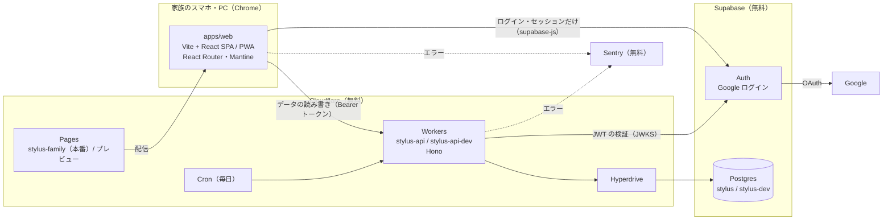

# 001 基盤 設計

spec: ./spec.md

> Lティアだけで作る。spec.md の要件をどう実現するかの方針を書く。
> 要件そのもの（何を作るか）は spec.md に書き、ここには書かない。
> 選定理由の比較検討のうち、後から参照されるものは ADR に残す。

## 背景と目標

- 家族4人のためのアプリの最初の spec。ご飯・車・お金の各機能を載せる土台を作る
- 目標：家族が Google でログインしてホーム画面から開ける状態を作ること。あわせて、各機能の spec が「API を1本足して画面を1枚足す」だけで作り始められる状態にすること
- 材料：設計フェーズでオーナーが承認した決定（アカウント・認証・権限、端末と形態、技術とアーキテクチャ、実物で確かめる項目、未決定事項）。技術判断の理由は ADR-0001〜0006 に残した

## 非目標

- 各機能（ご飯・車・お金）の API・テーブル・画面
- Web プッシュ（作れない日の spec で作る）
- 家族の登録・権限を変える画面、管理者だけの機能
- オフラインでデータを見ること、バックアップ

## 全体構成



### 環境の組み合わせ

| 環境 | フロント | API | DB・Auth | どこから作られるか |
|---|---|---|---|---|
| 本番 | Pages の本番（`stylus-family.pages.dev`） | `stylus-api` | Supabase `stylus` | `main` |
| 開発 | Pages のプレビュー（`develop` と `spec/*` の各ブランチ） | `stylus-api-dev` | Supabase `stylus-dev` | `develop`（API）、各ブランチ（フロント） |
| ローカル | `http://localhost:5173`（Vite の開発サーバー） | `wrangler dev`（開発用の設定） | Supabase `stylus-dev` | 手元 |

- フロントの接続先（Supabase の URL・公開キー・API の URL）は、Pages の環境変数を「本番」と「プレビュー」で分けて渡す
- Supabase Auth の Redirect URLs：本番は本番のフロントだけ。開発はプレビューの URL（`https://*.stylus-family.pages.dev/**`）と localhost

### デプロイ

| 対象 | 方法 |
|---|---|
| フロント | Cloudflare Pages の Git 連携。`main` は本番、それ以外のブランチはプレビューとして自動でデプロイ |
| API | GitHub Actions で `wrangler deploy`。`develop` への push で `stylus-api-dev`、`main` への push で `stylus-api` |
| DB のマイグレーション | GitHub Actions で Drizzle Kit の `migrate` を流す。`develop` への push で `stylus-dev`、`main` への push で `stylus`。API のデプロイより先に流す（同じワークフローの前段） |
| spec ブランチの開発中 | 同じワークフローを手動実行（`workflow_dispatch`）でき、`spec/*` のブランチを選んで `stylus-dev` へのマイグレーションと `stylus-api-dev` へのデプロイを流せる。手動実行で流せる先は開発だけで、本番には流せない（2026-09-27 オーナー決定） |
| 秘密情報の置き場所 | Workers の secret は管理者が `wrangler secret put` で一度だけ入れる。GitHub Actions の secret には Cloudflare の API トークンと、マイグレーション用の DB 接続情報を置く（GitHub の Environments で `development` / `production` に分ける） |

### リポジトリ構成

```
apps/
  web/        Vite + React（TypeScript）。ルーティングは React Router、見た目は Mantine、PWA は vite-plugin-pwa
  api/        Hono（TypeScript）。wrangler.toml に本番と [env.dev]
packages/
  shared/     フロントと API で共有する型・Zod スキーマ・ルール（日本時間の日付など）。パッケージ名 @stylus/shared
  repo-checks/ リポジトリ全体の検査だけを持つテスト用パッケージ（秘密情報・lint のルール）
.github/workflows/
  ci.yml      PR ごとに pnpm lint と pnpm test、秘密情報の検査
  deploy-api.yml  マイグレーション → wrangler deploy（develop → 開発、main → 本番）
```

- `apps/web` から `apps/api` への import は `import type` だけ（ESLint のルールで止める。COMMON-N-010）

### ブランチ運用（2026-09-27 決定・GitHub 設定済み）

| ブランチ | 役割 | 入り方 |
|---|---|---|
| `main` | 本番。Cloudflare Pages の本番ブランチ | `develop` から PR。マージコミットで入れる（squash すると develop と履歴がずれるため） |
| `develop` | 開発の統合先。GitHub の既定ブランチ | `spec/NNN-<name>` から PR。squash で入れる |
| `spec/NNN-<name>` | spec 1件ぶんの作業（文書・実装とも） | `develop` から切る。マージ後に自動削除される |

- GitHub の設定：既定ブランチ `develop`、squash とマージコミットを許可・rebase は禁止、マージ後にブランチを自動削除
- ブランチ保護（ルールセット）は設けない。private リポジトリでは無料プランで使えず、学生特典（GitHub Pro）に頼らない方針のため
- 既定ブランチを `develop` にしているのは、自動削除で `develop` が消えないようにするため（既定ブランチは自動削除されない）

## データモデル

### members（家族）

| 列 | 中身 | 制約 |
|---|---|---|
| `id` | 家族の ID（各機能のテーブルはこれを参照する） | 主キー、uuid |
| `auth_user_id` | Supabase Auth の利用者 ID | 一意、NULL 可（家族の登録の手順で埋める。空のまま残るのは V-1 の代替を採ったときだけ） |
| `email` | Google アカウントのメールアドレス | 一意、空不可、小文字だけ（`CHECK (email = lower(email))`。手作業で大文字を入れたら拒否される） |
| `display_name` | 表示名 | 空不可（空白だけも不可） |
| `is_admin` | ロール「管理者」 | 既定 false |
| `is_parent` | 立場「親」 | 既定 false |
| `is_cook` | 立場「料理担当」 | 既定 false |
| `created_at` | 登録日時（UTC） | 既定 now() |

- 家族の照合：API はトークンの `sub` で `auth_user_id` を探す。見つからなければ 403。家族の登録の手順で `auth_user_id` まで埋めるので、ふだんの照合は `sub` だけで済む（2026-09-27 オーナー決定。管理画面で作った利用者は `app_metadata.provider` が `email` のまま残る見込みで、メールでの紐づけを主な経路にすると初回ログインが 403 になるため）
- メールでの紐づけは、V-1 の代替（サインアップを許可する）を採ったときだけ有効にする。そのときは、次の条件をすべて満たすときだけ、トークンのメールアドレス（小文字にしたもの）で `email` を探して `auth_user_id` を書き込む
  - 紐づける先は `auth_user_id` が NULL の行だけ（すでに誰かに紐づいた行は奪えない）
  - 判定には、利用者が書き換えられない claim だけを使う。`app_metadata.providers` に `google` が入っていることを確かめる。`user_metadata`（`email_verified` など）は利用者が書き換えられるので使わない
  - Supabase Auth では Google 以外のログイン方法（メール・パスワードなど）を無効にしておく
- `email` と NULL 可の `auth_user_id` を持っておくと、V-1 がうまくいかず「サインアップを許可し、許可リストで止める」代替に切り替えても、表を変えずに済む
- ID を Auth の利用者 ID と分けるのは、利用者を作り直しても各機能のデータの持ち主が変わらないようにするため
- RLS を有効にし、ポリシーは作らない。Data API もあわせて無効にする（COMMON-N-003）

## API

| 経路 | 認証 | 中身 |
|---|---|---|
| `GET /me` | 要 | `{ id, displayName, isAdmin, isParent, isCook }`。Zod スキーマは `@stylus/shared` |
| Cron（scheduled） | — | Supabase に1回問い合わせる（第一候補は DB への `select`。V-2 の結果で決める）。失敗したら Sentry へ |

ミドルウェアの順番：CORS → エラー処理（500 と Sentry）→ トークンの検証 → 家族の照合 → 各ルート（必要なら立場の判定）

- トークンの検証：Supabase の JWKS（`/auth/v1/.well-known/jwks.json`）の公開鍵で署名を確かめる（ライブラリは `jose`）。鍵は Worker のメモリに置いて使い回す。非対称鍵（ES256）の検証は CPU 10ms に十分収まる見込み
- ロール・立場の判定：`requireAdmin()`（ロール）と `requireAttribute('cook')`（立場）のような関数を用意し、各機能のルートに付ける（COMMON-N-002）
- エラーの形：`{ error: { code, message } }`。401 `unauthenticated`、403 `not_a_member` / `forbidden`、500 `internal`

## フロント

- ルーティング：React Router。ログイン画面（`/login`）、アプリのホーム（`/`）、Google から戻る先（`/auth/callback`）。ログインしていなければ `/login` へ、ログイン済みで `/login` を開いたら `/` へ送る
- ログイン：supabase-js の `signInWithOAuth({ provider: 'google' })`（PKCE）。セッションは supabase-js が端末の保存領域（localStorage）に持ち、アクセストークンの更新も任せる
- 未登録の知らせ方（AUTH-F-002/AC-2）：次のどちらでも「この Google アカウントは登録されていません。…」を出し、端末のセッションを消す
  - サインアップ無効のため、Supabase が Google から戻る先にエラー（`error_code=signup_disabled` など）を付けて返したとき
  - ログインはできたが、`GET /me` が 403 `not_a_member` を返したとき（V-1 の代替を採った場合や、家族の登録から外された場合）
  - Google の画面でキャンセルして戻ったとき（`error=access_denied`）は、メッセージを出さずにログイン画面に戻す（AUTH-F-002/AC-7）
  - それ以外のエラーは「ログインできませんでした。…」にする
- ログアウト（AUTH-F-004）：`signOut({ scope: 'local' })` を使い、ほかの端末のセッションは取り消さない。supabase-js は通信エラーのときに端末のセッションを消さずにエラーを返すことがあるので、その場合は保存領域のセッションを自分で消してからログイン画面へ送る
- 通信できないとき（AUTH-F-003、APP-F-001）：Service Worker（vite-plugin-pwa）で画面の HTML・JS・CSS を端末に保存しておき、API や Supabase への要求がネットワークエラーになったら「通信できません。…」を出す。端末のセッションは消さない。API が 500 など失敗を返したときも、セッションは消さずに「うまく読み込めませんでした。…」を出す（AUTH-F-003/AC-7）。セッションを消すのは、ログアウトしたとき、Supabase がログイン状態を無効と返したとき、API が 403 `not_a_member` を返したときだけ
- API が 401 を返したとき（署名鍵の入れ替え直後や端末の時計のずれなどで、端末では期限内に見えても起こりうる）：セッションを1回だけ更新して送り直す。更新がログイン状態の無効で失敗したらログイン画面へ、通信エラーなら「通信できません。…」、送り直しても 401 なら「うまく読み込めませんでした。…」を出す
- 新しい版への切り替え（APP-F-001）：新しい Service Worker は、使っている最中には切り替えず、次に開いたときに使う（入力中の内容が消えないように）

## テストの方針

- API：Hono の `app.request()` で呼ぶ。トークンはテストの中で作った鍵で署名し、JWKS を差し替える。DB は PGlite（Node で動く Postgres）に Drizzle のマイグレーションを当てて使う（開発用の Supabase を共有しないため）
- フロント：Vitest と Testing Library（jsdom）。supabase-js は差し替える
- リポジトリ全体の検査（COMMON-N-004 の秘密情報、COMMON-N-010 の lint のルール）：テストだけを持つパッケージ `packages/repo-checks/` に置く（CLAUDE.md のテストの置き場所に入るように）
- 手で確かめるもの（AC にはしていない。リリース前に確かめる）：
  - Google ログインを本物で通す（登録済み・未登録の両方）
  - Android の Chrome で端末のホーム画面に追加し、アドレスバーなしで開くこと、新しい版に切り替わること
  - 2台の端末で、片方のログアウトがもう片方に響かないこと
  - 公開キーで Data API を呼んで読めない・書けないこと（本番・開発）
  - CPU 時間（COMMON-N-007）、画面幅と押せる大きさ（COMMON-N-008）
  - PR ごとに GitHub Actions が走り、結果が PR に出ること（最初の PR で）
  - 端末のホーム画面のアイコンから開いた状態（standalone）で、ログアウト → Google で再ログインして、アプリのホームに戻れること
- CI で確かめるもの：フロントのビルド成果物に秘密情報の値の形が無いこと（COMMON-N-004 の測り方）。形の定義は `packages/repo-checks/src/secret-patterns.ts` にだけ置き、成果物は `scan-build.ts` で調べる
- 例のファイル（`.env.example` など、git で追跡するもの）にはキー名だけを書き、値は空にする。仮の値でも接続文字列の形（`postgres://` など）を書くと COMMON-N-004/AC-1 の検査に引っかかるため

## 検討した代替案

| 案 | 採らなかった理由 |
|----|----------------|
| `members` の主キーを Auth の利用者 ID にする | V-1 の代替（サインアップ許可＋許可リスト）に切り替えると、ログイン前に行を作れなくなる |
| 家族の情報を Auth の `app_metadata` に持つ | 各機能のテーブルから外部キーで参照できない。管理画面での編集も手間 |
| 家族を登録するスクリプトをリポジトリに置く | 4人を一度登録するだけなので、設計フェーズの決定のとおり Supabase の管理画面の手作業で足りる（手順は `docs/architecture.md` の「家族の登録の仕方」） |
| JWT を共有シークレット（HS256）で検証する | Supabase の新しいプロジェクトは非対称鍵が標準。シークレットを Worker に置かずに済む |
| テストで開発用の Supabase（`stylus-dev`）を使う | 通信が要り、データが混ざり、CI に DB の接続情報を置くことになる |
| `develop` を置かず `main` だけで回す | オーナーが develop を挟む運用を選んだ（2026-09-27） |
| マイグレーションを管理者の手元から手動で流す | 流し忘れが起きる。オーナーが GitHub Actions での自動を選んだ（2026-09-27） |
| spec ブランチの間は自動テスト（PGlite）だけで確かめ、開発 DB には develop へのマージ後に流す | 画面で触って確かめるのがマージの後になる。オーナーが手動実行で開発へ流せる形を選んだ（2026-09-27） |
| TanStack Router | 画面が数枚で、ルートの型付けの利点が小さい。オーナーが React Router を選んだ（2026-09-27） |
| Tailwind CSS ＋ shadcn/ui、UI ライブラリなし（CSS Modules） | 日付・時刻の入力やダイアログを組み立てる手間がかかる。オーナーが Mantine を選んだ（2026-09-27）。押せる部分の大きさ（COMMON-N-008）はテーマでまとめて決める |

## リスクと懸念

設計フェーズで挙げた、実物で確かめる項目（V-4 は作れない日の spec へ移した）。実装の最初に確かめ、だめなら代替に切り替える。

| # | 確かめること | だめなときの代替 | 要件への影響 |
|---|---|---|---|
| V-1 | サインアップ無効のまま、事前登録した利用者が Google でログインでき、同じメールの利用者に紐づくか | サインアップを許可し、`members` に無い人は API が 403（上の「家族の照合」のまま動く）。Auth の「利用者作成前」フックで許可リスト外を拒否できるなら使う。この代替を採るときは、Google 以外のログイン方法を無効にしたうえで、CLAUDE.md の「一般公開のサインアップは無効」をどう直すかをオーナーに確認する。あわせて、管理画面で作った利用者の `app_metadata`（`provider` / `providers`）が Google でログインした後にどうなるかも確かめる | 未登録の人への表示は、どちらの方式でも「未登録の知らせ方」のとおり同じになる。ただし代替を採ったときは、AUTH-F-001 の「処理に失敗」のうち「家族の登録だけが残ったときはサインアップ無効で弾かれ」の部分が成り立たなくなる（登録だけが残っていても、ログインすれば家族として入れる）ので、spec を直す。あわせて、spec の変更差分 DB の「Auth の利用者との紐づけは家族の登録のときに行う」（初回ログインでのメール照合に変わる）と、移行計画の「家族の登録の仕方」（`auth_user_id` を空のまま登録する）も直す |
| V-2 | Data API を無効にした状態で、Cron からの DB への問い合わせが「アクセス」と数えられ、休止を防げるか | Auth の API（例 `/auth/v1/health`）を叩く。それでも足りなければ、アプリのデータを置かない専用のスキーマ（例 `keepalive`）だけを Data API で公開して叩く | COMMON-N-006 の AC は手段によらないので変わらない。COMMON-N-003（アプリのデータを読み書きできない）も保てる。ただし専用スキーマを公開する代替を採ったときは、spec の変更差分「Data API を無効」を「アプリのデータのスキーマは Data API に公開しない」に直す（spec-verify の前に） |
| V-3 | Workers の無料プランで Hyperdrive から Supabase につなげるか | Supavisor のトランザクションモード（`prepare: false`）。この場合、接続文字列を Workers の secret に置く | なし |
| V-5 | Pages のプロジェクト名 `stylus` が使えるか | **確かめ済み（2026-09-27）：`stylus.pages.dev` は他人が使っていて取れない。** プロジェクト名は `stylus-family`（`https://stylus-family.pages.dev`）にした（オーナー決定）。プロジェクトを作るときに実際にこの URL になったかを確かめ、違えば CORS と Supabase Auth に反映する | spec の COMMON-N-005 は `stylus-family.pages.dev` で書いてある |

### 検証の結果（T-2）

| # | 結果 | 日付 |
|---|---|---|
| V-1 | **合格。代替は不要で、spec は直さない。** 開発（`stylus-dev`）で確かめた：(a) Email のログイン方法を無効にしたままでも、管理画面（Add user → Create new user、Auto Confirm User）でメールアドレスの利用者を作れた。(b) サインアップ無効のまま、その利用者が Supabase の authorize URL から Google でログインできた。(c) 利用者は増えず（`auth.users` は1行のまま、`id` も同じ）、`auth.identities` に `google` が1件加わった。`raw_app_meta_data` はログイン前 `{"provider":"email","providers":["email"]}`、ログイン後 `{"provider":"email","providers":["email","google"]}`（`provider` は `email` のまま。見込みどおりで、`sub` で照合する方式のまま動く） | 2026-09-27 |
| V-2 | **第一候補（Cron から DB への `select`）で作る。** Supabase の公式情報（Project Pausing）は、休止の判断を「過去1週間の、利用者による DB の活動（user database activity / user queries）が足りないか」としており、Data API の経由かどうかは条件にしていない。Hyperdrive 経由の問い合わせは DB への問い合わせそのものなので、アクセスに数えられると判断した。公式情報は「たいてい1日に数回の問い合わせで足りる」としているので、毎日1回の Cron と家族の利用で足りるかを公開後に運用で見る（休止しかけたら回数を増やす） | 2026-09-27 |
| V-3 | **合格。代替（Supavisor のトランザクションモードを Workers から直接）は不要。** Hyperdrive の設定 `stylus-dev`（ID `d8d17c5944554666b7f8da0ec446cc06`、キャッシュ無効）を作り、`stylus-api-dev`（Workers Free、`nodejs_compat`、postgres.js）に一時的な確認用の経路を置いて `select 1` を3回投げ、すべて成功した（20〜70ms）。`now()` が毎回変わり、キャッシュが効いていないことも確かめた。確認用の経路は消して配置し直した。Hyperdrive の接続先は Supavisor のセッションモード（`aws-0-ap-northeast-1.pooler.supabase.com:5432`）。Cloudflare の手順は Supabase の直接接続を勧めているが、直接接続は IPv6 だけのため、IPv4 で使えるセッションモードで作った | 2026-09-27 |
| V-5 | **合格。** Pages のプロジェクト `stylus-family` を GitHub（`uchida-s07/Stylus`、本番ブランチ `main`、全ブランチでプレビュー）とつなぎ、URL は `https://stylus-family.pages.dev` になった。CORS・Supabase Auth の値は変えなくてよい | 2026-09-27 |

T-2 で決めたこと（2026-09-27 オーナー決定）：

- Supabase のリージョンは Tokyo（ap-northeast-1）。作るときに「Enable Data API」「Automatically expose new tables」を外し、「Enable automatic RLS」を入れた（RLS はマイグレーションでも有効にする。二重の備え）。JWT の署名鍵は最初から ECC（P-256）だった
- 本番の Supabase `stylus` は、T-25（本番に出す）の手前まで作らない。Cron（T-11）が動く前に作ると、7日間アクセスが無く休止するため。本番の Auth の設定と本番用の OAuth クライアントもそのときに行う
- Google の OAuth 同意画面は公開せず「テスト中」のまま使い、使う Google アカウントをテストユーザーに登録する。公開するにはホームページとプライバシーポリシーの URL が必須で、そのページが無いため。家族以外は Google の画面で止まる（Supabase のサインアップ無効に加えた守り）。テストユーザーは、同意から7日たつと Google の同意画面がもう一度出ることがある（アプリのログイン状態は Supabase が持つので切れない）。本番も「テスト中」のまま使い、家族4人の Google アカウントをテストユーザーに登録する（2026-09-29 オーナー決定。T-25 の準備のとき）
- 開発の Supabase の URL 設定：Site URL は `http://localhost:5173`、Redirect URLs は `http://localhost:5173/**` と `https://*.stylus-family.pages.dev/**`
- GitHub の Environments（`development` / `production`）は、private リポジトリでは GitHub Pro 以上でないと secret を置けない（GitHub Free では public リポジトリだけ）。オーナーは学生特典の GitHub Pro を使って、design のとおり Environments で分けることにした（案「リポジトリの secret を `DEV_` / `PROD_` の名前で分ける」は採らなかった）。ブランチ保護の節の「学生特典（GitHub Pro）に頼らない方針」は、Environments については例外になる。学生特典が切れると Environments の secret が使えなくなるので、そのときはリポジトリの secret を名前で分ける形に切り替える。Environments を使えるブランチも絞った（`production` は `main` だけ、`development` は `develop` と `spec/*`）。`spec/*` から本番に流せないことを、ワークフローの書き方だけでなく GitHub の設定でも守る
- Pages のビルド：ビルドコマンド `pnpm --filter web build`、出力 `apps/web/dist`、ルートはリポジトリの一番上。Node の版は `.node-version`（24）、pnpm の版は環境変数 `PNPM_VERSION`（本番・プレビューとも `12.6.0`。ビルド環境の既定は 10 系のため）で合わせる。`VITE_SUPABASE_URL`・`VITE_SUPABASE_PUBLISHABLE_KEY` はプレビューにだけ `stylus-dev` の値を入れ、本番は本番の Supabase を作るときに入れる

そのほかの懸念：

- Hyperdrive はクエリの結果をキャッシュする（既定で有効）。Cron の問い合わせがキャッシュで返ると DB に届かず、書き込んだ直後の読み取りで古い結果が返ることもあるので、Hyperdrive の設定でキャッシュを無効にする（2026-09-27 オーナー決定。家族4人の規模ではキャッシュの効果が小さい）
- Supabase の既定のままでは、ログイン状態に期限が無い。AUTH-F-003 の「7日」は下限の約束で、実際はもっと長く続く
- ブランチ保護が無いので、CI が失敗した PR をマージしないのは運用で守る
- Supabase の直接接続は IPv6 だけで、GitHub Actions の実行環境からはつながらないことがある。マイグレーションは Supavisor のセッションモード（IPv4 で使える）の接続文字列で流す
- spec ブランチから開発へ手動で流すと、`stylus-dev` のスキーマと `stylus-api-dev` が `develop` より先に進む。進行中の spec が2件以上あるときは、手動で流す前にほかの spec の作業とぶつからないかを確かめる
- マイグレーションは API より先に流れ、フロント（Pages）は別に配信される。古い API・フロントが新しいスキーマで動く時間があるので、列の削除や名前の変更は2回に分けて行う
- Supabase Auth のメール（招待など）は無料枠では送れる数が少ない。家族の登録では送らない手順にする

## 移行計画

既存のデータ・利用者はいない。最初に一度だけ行う準備（管理者の手作業）：

1. Supabase `stylus`・`stylus-dev` の Auth の設定：サインアップを無効にする、Google ログインを有効にする（Google Cloud で OAuth クライアントを作る。無料）、Google 以外のログイン方法を無効にする、Site URL と Redirect URLs を設定する。あわせて、JWT の署名鍵が非対称鍵（ES256）になっていることを確かめ（違えば切り替える）、古い形式の API キー（JWT の anon / service_role）を無効にする
2. Data API を無効にする
3. Cloudflare：Pages のプロジェクト `stylus-family` を GitHub とつなぐ、Workers の `stylus-api`・`stylus-api-dev` と Hyperdrive の設定を作り、secret を入れる
4. GitHub の Environments（`development` / `production`）に Cloudflare の API トークンと DB 接続情報を入れる
5. 開発：`develop` への push で `stylus-dev` に最初のマイグレーションを流し、開発に家族を登録する（下の「家族の登録の仕方」。少なくとも管理者）。開発で Google ログインを確かめる
6. 本番：`develop` を `main` にマージして `stylus` にマイグレーションを流し、本番に家族4人を登録する（同じ仕方）
7. 各自のスマホで本番の URL を開いて Google ログインし、端末のホーム画面に追加する（管理者が手伝う）

家族の登録の仕方：Auth の管理画面で利用者を作る（メールを送らない方法で）→ SQL エディタで `members` に表示名・立場・ロールを入れる。`auth_user_id` には `auth.users` からそのメールアドレスの利用者 ID を引いて入れる（1文の INSERT … SELECT に `RETURNING id, email, auth_user_id` を付ける）。メールアドレスを打ち間違えると0件のまま成功扱いで終わるので、1人ごとに結果が1行表示されることを確かめ、最後に `members` を SELECT して人数がそろい、全員の `auth_user_id` が埋まっていることを確かめる。登録する値（2026-09-27 時点）：せいご＝管理者、父・母＝親、母＝料理担当

この節の手順（とくに家族の登録の仕方）は、/spec-close のときに常設の場所（`docs/architecture.md` の運用の節）へ移し、AUTH-F-001 の「決められた手順」がそこを指すようにする。design.md の中の handoff への参照は、ADR 番号と、handoff に頼らない書き方に置き換えた（2026-09-29。handoff は消す予定の一時資料のため）。

## 残すべき ADR の候補

| 判断 | 理由 | ADR |
|-----|------|-----|
| フロントとバックエンドの完全分離 | 将来のネイティブアプリ移行、役割分離による堅牢さ | [ADR-0001](../../adr/0001-separate-frontend-and-backend.md) |
| フロントは Vite ＋ React（Next.js 静的出力から変更） | 静的ホスティングに素直で、Next.js の機能はほぼ使えないため | [ADR-0002](../../adr/0002-frontend-vite-react.md) |
| Google ログイン＋事前登録、家族の照合は `members` の表で行う | 全員 Google アカウントを持つ。メール送信が要らない。V-1 の結果に左右されない | [ADR-0003](../../adr/0003-google-login-and-preregistration.md) |
| Supabase Auth ＋ Postgres、Data API は塞ぎ Hono 経由 | 認可を API に集約する | [ADR-0004](../../adr/0004-supabase-with-data-api-closed.md) |
| JWT は JWKS（非対称鍵）で検証する | シークレットを Worker に置かずに済む | [ADR-0005](../../adr/0005-jwt-verification-with-jwks.md) |
| DB 接続は Hyperdrive（V-3 の結果次第で Supavisor） | 検証の結果を残す | [ADR-0006](../../adr/0006-db-connection-via-hyperdrive.md) |
| 配布形態は PWA | Google Play の登録費がかかるため | —（ADR にしない） |
| ブランチ運用（main / develop / spec/*） | Pages の本番とプレビューの分け方に直結する | —（ADR にしない） |
| マイグレーションは GitHub Actions で自動、DB 接続情報を GitHub の secret にも置く | 秘密情報の置き場所の例外になるため | —（ADR にしない） |
| ローカル環境は Windows に直接構築 | 必要なツールが揃っている | —（ADR にしない） |
