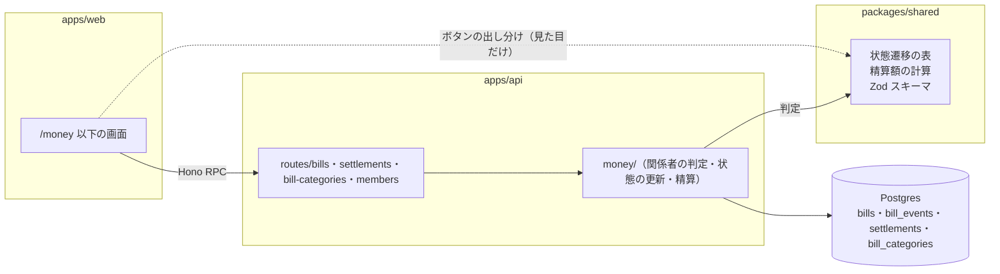
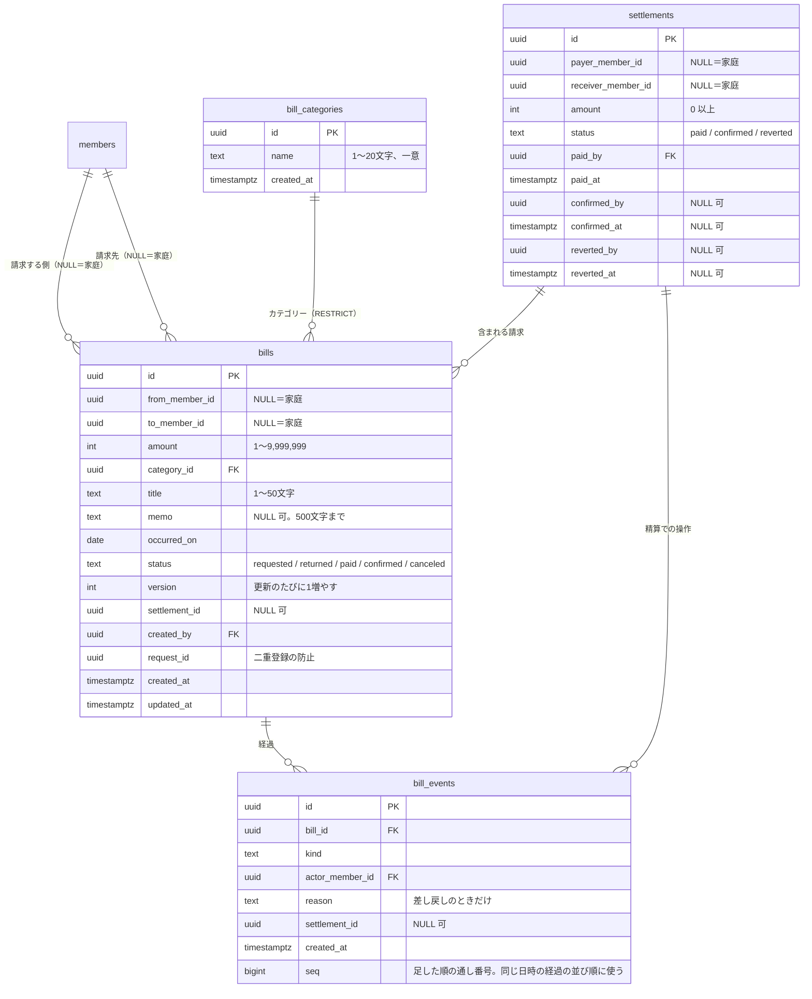

# 002 お金（請求・支払いの記録） 設計

spec: ./spec.md

> Lティアだけで作る。spec.md の要件をどう実現するかの方針を書く。
> 要件そのもの（何を作るか）は spec.md に書き、ここには書かない。
> 選定理由の比較検討のうち、後から参照されるものは ADR に残す。

## 背景と目標

- 001（基盤）の上に載せる最初の機能。家族の間の請求と支払いの記録、差し引きの精算、請求のカテゴリーを作る
- 目標：
  - 請求の状態（請求中・差し戻し・支払済・確認済・取消）を、API が1か所のルールで守る
  - 「家庭」を、父母のどちらからでも操作できる1人の当事者として扱う
  - 同時の操作（父母が同時に払う、開いている間に相手が直すなど）で、記録が食い違わないようにする
- 材料：spec.md の要件、handoff 2.3・2.4（オーナー承認済み）、2026-10-04 のオーナー決定（spec.md の未決事項の欄）

## 非目標

- 通知（請求・支払い・精算）。作れない日の spec で Web プッシュの仕組みを入れてから足す
- 集計（年別・カテゴリー別）、割り勘
- 画面のデザインの作り込み（Mantine の部品を素直に使う）
- オフラインでの入力（通信できないときは知らせて、入力を残すだけ）

## 全体構成

001 の構成（architecture.md）を変えない。API にルートを足し、DB に表を足し、画面を足すだけ。

- 状態遷移の表と精算額の計算は `packages/shared` に置き、API（判定）と画面（ボタンの出し分け・表示）が同じものを使う。判定するのは API だけ（COMMON-N-002）
- API の中では、ルートは入力の検証と応答だけにし、関係者の判定・状態の更新・精算は `apps/api/src/money/` にまとめる

## データモデル

### 当事者（「家庭」）の表し方

[ADR-0007](../../adr/0007-party-as-member-id-with-household-null.md) に判断を残した。

- 当事者は `members.id` で表し、「家庭」は NULL で表す（`from_member_id`・`to_member_id`・`payer_member_id`・`receiver_member_id`）
- DB の制約で守ること：
  - 両方が NULL にならない（「家庭」から「家庭」は無い）
  - 両方が同じ家族にならない（自分に請求しない）
- `members` を指す外部キー（当事者・`created_by`・`actor_member_id`・`paid_by`・`confirmed_by`・`reverted_by`）は、どれも `ON DELETE RESTRICT` にする。お金の記録がある家族の行は消せない。相手の家族の記録が知らないうちに消えないようにするため。家族の登録を外す必要が出たら、`members` に「使えなくする」印を足すなどを、そのときの spec で決める（2026-10-04 オーナー決定）
- 「家庭」が請求する側のとき請求先は息子だけ、親は「家庭」宛てにできない、といった名義が絡む規則は、members の立場「親」（`is_parent`）を見る必要があるので API で守る
- 関係者の判定（MONEY-N-001）：家族 M が請求の関係者になるのは、次のどれかのとき
  - `from_member_id = M`
  - `to_member_id = M`
  - M が親で、`from_member_id` か `to_member_id` が NULL
  - 一覧はこの条件を SQL の WHERE に入れて絞る。中身・操作は、同じ条件で見つからなければ 404

### 状態遷移

| 今の状態 | 操作 | 誰が | 次の状態 | 経過の種類 |
|---|---|---|---|---|
| （なし） | 登録 | 請求する側 | 請求中 | `created` |
| 請求中 | 直す | 請求する側 | 請求中 | `edited` |
| 差し戻し | 出し直す（直してもよい） | 請求する側 | 請求中 | `resubmitted` |
| 請求中・差し戻し | 取り消す | 請求する側 | 取消 | `canceled` |
| 請求中 | 払った | 請求先側 | 支払済 | `paid` |
| 請求中 | 差し戻す | 請求先側 | 差し戻し | `returned` |
| 支払済（精算に入っていない） | 受け取った | 請求する側 | 確認済 | `confirmed` |
| 支払済（精算に入っていない） | 払ったを取り消す | 請求先側 | 請求中 | `payment_canceled` |
| 支払済（精算に入っていない） | 受け取っていない | 請求する側 | 請求中 | `not_received` |
| 請求中（精算の対象） | まとめて払った | 精算の払う側 | 支払済 | `settled_paid` |
| 支払済（精算に入っている） | まとめて受け取った | 精算の受け取る側 | 確認済 | `settled_confirmed` |
| 支払済（精算に入っている） | 精算ごと戻す（払った側／受け取る側） | 精算の関係者 | 請求中（`settlement_id` を外す） | `settlement_payment_canceled` / `settlement_not_received` |

- この表を `packages/shared` に1つだけ置く。API は操作の前にこの表で「今の状態でこの側が行えるか」を確かめる
- 側が違うときは 403、状態が違うときは 409 `state_changed` を返す
- 差し引き 0円 の精算は、`payer_member_id` に「まとめて払った」を押した側を入れる。受け取る側はもう一方になる

### 同時の操作

[ADR-0008](../../adr/0008-optimistic-locking-with-version.md) に判断を残した。

- **1件の操作**（直す・払った・差し戻す・受け取った・戻す・取り消す）は、画面が持っている `version` を付けて送る。API は次の順に行う
  1. 請求を読み、関係者でなければ 404（MONEY-N-001）
  2. 操作に要る側（請求する側・請求先側）でなければ 403
  3. 状態遷移の表で、今の状態でその操作ができなければ 409 `state_changed`
  4. 条件付きの更新を1文で行う：`UPDATE bills SET … , version = version + 1 WHERE id = ? AND status = ? AND version = ?`
  - 1〜3 の判定は、関係者と側が変わらない（当事者は直せない）ので、更新の前に1回だけ行えばよい
  - 4 が0行なら、1 の後に別の人が状態か中身を変えたということ。409 `state_changed` を返す。エラーの形は既存の `{ error: { code, message } }` のまま変えない。画面は 409 を受けたら請求を取り直し、状態が見ていたときと同じなら「中身が変わりました」、違えば「状態が変わりました」と出し分けて、最新の請求を出す
  - 父母が同時に「払った」を押しても、通るのは先の1回だけ（MONEY-F-006/AC-4）
  - 更新と経過の追加は1つのトランザクションで行う
- **まとめて払った**：画面は見ていた請求の `{ id, version }` の一覧と精算額を送る。API は1つのトランザクションで次の順に行う
  1. 2者の間の請求中の請求を `SELECT … FOR UPDATE` で読む
  2. 送られた一覧と、ID と版が完全に一致するかを確かめる。一致しなければ何も変えず、409 `state_changed` を返す（画面は精算額を取り直して最新の精算を出す）
  3. 精算額を計算し直して一致を確かめる
  4. `settlements` を1行足す
  5. 請求をまとめて支払済にし、`settlement_id` を入れる
  6. 経過を足す
  - 全部が成功するか、何も変わらないかのどちらかになる
  - 画面を開いた後、API が手順1で読むより前に請求が増えていたら、手順2で一致しないので止める（MONEY-F-011/AC-4）
  - API が手順1で読んだ後（トランザクションの途中）に別の人が新しい請求を足したときは、その請求は精算に入らず請求中のまま残る。利用者が見て確かめた中身だけを精算する
- **まとめて受け取った・精算ごと戻す**も、精算と含まれる請求を1つのトランザクションで更新する。精算の状態を条件にした更新で、二重の操作を防ぐ
- **二重登録**：画面は入力を開いたときに `request_id`（UUID）を作り、登録のたびに同じ値を送る。`(created_by, request_id)` を一意にする。同じ組み合わせが来たら、すでにある請求と中身（請求する側・請求先・金額・カテゴリー・件名・メモ・発生日）を比べる。同じならすでにある請求を返し（MONEY-F-001/AC-14）、違えば登録せずに 409 `already_registered` を返す（MONEY-F-001/AC-16。直した中身を黙って捨てないため）。あわせて、送っている間は「請求する」を押せなくする
- **カテゴリーの削除と登録の競合**：`bills.category_id` の外部キーを `ON DELETE RESTRICT` にする。削除が外部キーの違反で失敗したら 409 `in_use` を返す。登録の側でカテゴリーが無ければ 400 `invalid_input`（「カテゴリーが見つかりません」）を返す（MONEY-F-001/AC-11、MONEY-F-014/AC-4）

### 合計と精算額

- **合計**（MONEY-F-004）は SQL の集計で求める（`status = 'requested'` だけ、向きごとに SUM）。親には、当事者が NULL（家庭）の分を別に集計して返す
- **精算額**（MONEY-F-010）：2者の間の請求中の請求を読み、`packages/shared` の計算で向きごとの小計と差し引きを出す。件数は多くても数十件の想定で、CPU 時間は小さい

## API

- ルートは spec.md「3. 変更差分」の表のとおり。どれも Hono RPC の型が画面に届くように `createApp` の `.route()` で足す
- `GET /settlements/preview` が `GET /settlements/:id` に当たらないよう、`:id` は uuid の形で検証し（形が違えば 404）、`preview` を `:id` より先に登録する。請求の `:id` も同じく uuid の形で検証する
- 入力は `packages/shared` の Zod スキーマで検証し、違反は 400 `invalid_input`（項目ごとのメッセージを付ける）
- 応答の金額は整数（円）、日付は `YYYY-MM-DD`（日本時間）、日時は ISO 8601（UTC）。画面で日本時間にして出す
- 「今日」（発生日の上限）は API でも `toJstDate()` で求める（COMMON-N-009）
- 名義と側の判定は、既存の `requireAttribute('parent')` では足りない（「家庭」の名義で操作するときだけ親が要る）。そのため `money/` の関係者の判定でまとめて行う
- `GET /members` は家族全員の `id`・`displayName`・`isParent` だけを返す。メールアドレスなどは返さない

## 検討した代替案

| 案 | 採らなかった理由 |
|----|----------------|
| 「家庭」を `members` の1行として登録する | `members` は Supabase Auth の利用者と1対1で、ログインする人の表。ログインしない行を混ぜると、家族の照合・登録の手順・立場の列の意味が崩れる |
| 当事者の表（`parties`）を別に作り、家族4人ぶん＋「家庭」を入れる | 当事者は5つで増えない。表を1つ増やすほどの得が無い。NULL＝家庭の表し方で、制約と関係者の判定が書ける |
| 精算を記録せず、まとめて払ったときに請求の状態だけ変える | 精算ごと受け取る・戻す（MONEY-F-009・012）と、経過に精算額を出す（MONEY-F-005/AC-5）には、まとまりの記録が要る |
| 1件の操作も `SELECT … FOR UPDATE` で行をロックする | 条件付きの更新1文で足りる。ロックの往復が減り、Workers の時間も短い |
| 経過を持たず、請求の表に「払った人・日時」などの列を並べる | 戻す・出し直すで同じ操作が何度も起きる。経過を行で持てば、順に並べるだけで出せる |
| 状態ごとに `paid_at` などの列を持ち、状態の列を持たない | 一覧・合計・精算の絞り込みが複雑になる。状態の列と経過の両方を持つ |

## リスクと懸念

| リスク | 対応 |
|---|---|
| Hyperdrive 経由でトランザクションと `FOR UPDATE` が使えるか | Hyperdrive はトランザクションの間、同じ接続を割り当てる（transaction mode）ので使える見込み。トランザクションの外で接続ごとの状態（`SET` など）を前提にしない。最初のタスクで開発環境（stylus-dev）で確かめる。PGlite のテストでも同じ SQL を通す。**確認済み（2026-10-05、T-2）**：`wrangler dev --env dev --remote` で stylus-dev の Hyperdrive を通し、Drizzle の `db.transaction` の中で (1) `txid_current()` と `pg_backend_pid()` を2回呼んで同じ値（同じ接続・同じトランザクション）、(2) `members` を `SELECT … FOR UPDATE` で読み、同じ行を更新できた、(3) 更新の後に例外を投げると、トランザクションの外で読み直した値は更新の前に戻っていた。方針どおり使える |
| 起動直後の CPU 時間が 10ms を超える（既知。docs/review-notes.md） | ルートを足すと初回の読み込みが少し増える。デプロイ後に Workers のダッシュボードで 1102 エラーが出ていないかを確かめる |
| 状態遷移の規則が API と画面でずれる | 表を `packages/shared` に1つだけ置き、両方から使う。表そのものを単体テストする |
| 請求の数が増えて一覧が重くなる | 家族4人で年に数百件の想定。`bills` に当事者と状態の索引を張る。ページ分けは今は作らない。履歴（片付いた請求）の一覧は年ごとに増え続けるので、片付いた請求が1,000件を超えたら、Workers のダッシュボードで `GET /bills?view=closed` の CPU 時間（COMMON-N-007 の 10ms）を測り直す。超えそうなら、件数の上限かページ分けを別の spec で足す |
| 「家庭」の請求を親が別々の端末で同時に操作する | 版つきの条件付き更新で、後の操作を 409 にする（上の「同時の操作」） |

## 移行計画

- マイグレーションを1本足す：4つの表、制約、索引、RLS の有効化、カテゴリー5つの投入。データの移し替えは無い（既存のお金のデータは無い）
- 順番：develop へのマージで、開発の DB へのマイグレーション → stylus-api-dev のデプロイが流れる（001 の deploy-api.yml）。その後、main へのマージで本番に流れる
- 画面は API より後に配信されても、お金の画面を開くまで新しい API を呼ばない。そのため、順番のずれで壊れることはない
- 本番に出した後、公開キーで Data API を呼んで、新しい表を読めない・書けないことを確かめる（architecture.md の「定期的に確かめること」）

## 残すべき ADR の候補

2つとも ADR に残した（2026-10-04 オーナー決定。T-1）：[ADR-0007](../../adr/0007-party-as-member-id-with-household-null.md)、[ADR-0008](../../adr/0008-optimistic-locking-with-version.md)。

| 判断 | 理由 |
|-----|------|
| 請求の当事者を `members` の ID で表し、「家庭」を NULL で表す | 後から車・ご飯で「家庭」が出てきたときの前例になる。代替案（members に1行足す、当事者の表）を退けた理由を残す |
| 状態の更新を、版つきの条件付き更新（楽観的な排他）で行う | 今後の機能（車の予約の変更など）でも同じやり方を使う前例になる |
