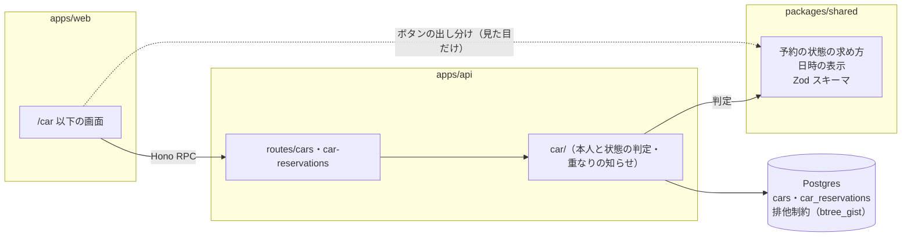
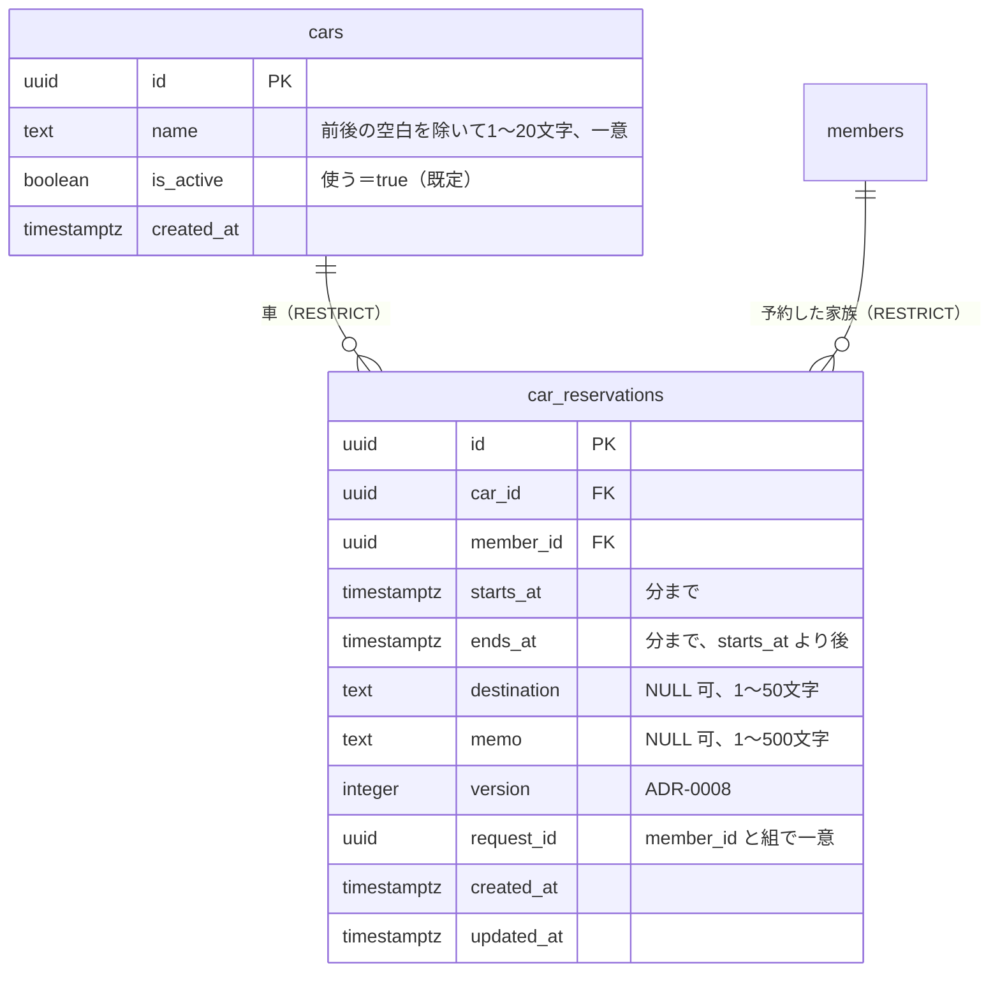

# 003 車（車の登録と予約） 設計

spec: ./spec.md

> Lティアだけで作る。spec.md の要件をどう実現するかの方針を書く。
> 要件そのもの（何を作るか）は spec.md に書き、ここには書かない。
> 選定理由の比較検討のうち、後から参照されるものは ADR に残す。

## 背景と目標

- 001（基盤）の上に載せる2つ目の機能。家族で共有する車の登録と、予約（入れる・見る・直す・取り消す・履歴）を作る
- 目標：
  - 同じ車で時間が重なる予約を、同時に送られても DB が1か所で止める（先に保存された方が勝つ）
  - 「これから・使用中・終わった」を、保存した状態ではなく今の時刻から求め、API と画面で同じ求め方を使う
  - 予約の変更・取消は本人だけに限る。開いた後の変更（直す）はお金と同じ方式（版。ADR-0008）で見分け、取り消しは版を見ない
- 材料：spec.md の要件、handoff 2.2（オーナー承認済み）、2026-10-07 のオーナー決定（車の名前の変更、期間の上限なし、初期データの BMW）

## 非目標

- 通知（予約が入った・変わった）。作れない日の spec で Web プッシュの仕組みを入れてから足す
- カレンダー形式の表示（月・週の表）。日付ごとの一覧で J-6・J-7 に足りる
- 予約の繰り返し（毎週○曜など）
- オフラインでの入力（通信できないときは知らせて、入力を残すだけ）

## 全体構成

001 の構成（architecture.md）を変えない。API にルートを足し、DB に表を足し、画面を足すだけ。

- 予約の状態の求め方（開始・終了と今の時刻から、これから・使用中・終わった）は `packages/shared` に置き、API（判定）と画面（ボタンの出し分け・「使用中」の印）が同じものを使う。判定するのは API だけ（COMMON-N-002）
- API の中では、ルートは入力の検証と応答だけにし、本人と状態の判定・重なりの知らせの組み立ては `apps/api/src/car/` にまとめる（お金の `money/` と同じ分け方）

## データモデル

### 重なりの防ぎ方

- `car_reservations` に排他制約を付ける：`EXCLUDE USING gist (car_id WITH =, tstzrange(starts_at, ends_at, '[)') WITH &&)`
  - `[)`（開始を含み終了を含まない）なので、12:00 に終わる予約と 12:00 に始まる予約は重ならない（spec の「時間が重なる」）
  - `car_id` の `=` を gist で扱うために `btree_gist` が要る。Supabase では `create extension if not exists btree_gist with schema extensions` で有効にする
  - 同時に送られた2つの予約は、片方の保存が終わるまでもう片方が待ち、後の方が制約違反（`23P01`）になる。API はこれを 409 `overlap` にする
- 重なった相手の予約（表示名・開始・終了）は、制約違反を受けた後に1回だけ問い合わせて知らせに付ける（重ならない普通の登録では余分な問い合わせをしない）
- 排他制約は Drizzle のスキーマでは書けないので、0003_money.sql と同じく、Drizzle Kit が生成した 0004 のファイルに手で SQL を足す（先頭に拡張の有効化、末尾に排他制約と初期データ）。スキーマのファイルには、制約の名前と中身をコメントで残す

### そのほかの持ち方

- 文字列は、お金と同じく前後の空白を除いた値を保存し、文字数は `char_length`（コードポイント）で数える。CHECK で守る
- 日時は `timestamptz`。秒・ミリ秒が0であることを CHECK で守る（`date_trunc('minute', x) = x`）。日本時間への変換は表示と日付の区切りのときだけ行う。日付（日付ごとの見出し・曜日）は既存の `toJstDate()` で求め（COMMON-N-009。日付の求め方を2つにしない）、時刻（`9:00`）の表示の部品も同じ UTC+9 の足し算を土台にして `packages/shared/src/date.ts` に足す
- 取り消しは行を消す（`DELETE`）。経過の表は持たない。消すので、車の削除を止める外部キー（RESTRICT）は取り消していない予約だけで効き、CAR-F-003/AC-4（取り消した予約しか無い車は消せる）がそのまま成り立つ
- 「予約があるか」（車の管理で「削除」を出すか）は、一覧を返すときに `EXISTS` で求める。「使わないにする」の確認に出す「これからの予約の件数」も、同じ一覧で `ends_at > now` の件数として返す
- 一覧の問い合わせのために `car_reservations (ends_at)` に索引を張る（これから：`ends_at > now` を `starts_at` の順、履歴：`ends_at <= now` を `(ends_at, id)` の逆順でカーソル送り）。家族4人・車1〜2台の規模では件数は年に数百件で、索引は念のため
- 初期データ：マイグレーションで `cars` に「BMW」（使う）を1行入れる（お金のカテゴリーの初期データと同じやり方）

## API

### 予約の状態と操作の可否

| 状態（今の時刻から求める） | 直す | 取り消す |
|---|---|---|
| これから（まだ始まっていない） | 本人：車・開始・終了・行き先・メモ | 本人 |
| 使用中（開始 ≤ 今 < 終了） | 本人：終了・行き先・メモ（終了は開始より後なら今より前でもよい） | できない（409） |
| 終わった（終了 ≤ 今） | できない（409） | できない（409） |

- 直す要求は、送る項目の形で2つに分ける（2026-10-07 オーナー決定）。車・開始日時を含む要求は「まだ始まっていない予約の直し方」、含まない要求（終了・行き先・メモだけ）は「使用中の予約の直し方」。使用中の予約の画面は車・開始日時を送らない。予約の今の状態ではなく要求の形で条件を決めるので、直している間に予約が始まっても、まだ始まっていない予約の直し方の要求は止まる（CAR-F-006/AC-13）。使用中の予約に車・開始日時を含めて送ったら、値が同じでも 409（AC-9）
- 判定の順：形（400。車と開始日時は両方とも送るか、両方とも送らないか。片方だけなら 400）→ 予約があるか（404）→ 本人か（403）→ 要求の形と今の状態が合うか（409 `state_changed`）→ 移す先の車（400 `invalid_input`・409 `car_unavailable`）→ 版と更新
- 更新は ADR-0008 の条件付き更新1文で行う。状態の判定と更新の間に予約が始まる・終わる場合に備えて、時刻の条件も `WHERE` に入れる（まだ始まっていない予約の直し方は `starts_at > now`、使用中の予約の直し方は `ends_at > now`。要求の形で選ぶ）。0行なら取り直して、無ければ 404、状態が変わっていれば 409 `state_changed`、版だけ違えば 409 `state_changed`。画面は 409 を受けたら予約を取り直し、見ていたときと比べて「始まっていた」「終わっていた」「中身が変わっていた」で知らせを出し分ける（spec の CAR-F-006 の文言。お金の「状態が変わりました／中身が変わりました」の出し分けと同じ方式）
- まだ始まっていない予約を直している間に始まったときは、変えた項目にかかわらず止める（2026-10-07 オーナー決定。終了だけを直した場合も通さない）
- 取り消しの判定の順：予約があるか（404）→ 本人か（403）→ 状態（使用中・終わったなら 409 `state_changed`）→ 削除。直すと同じく、まず予約を読んで 404・403・409 を判定してから消す
- 取り消しは版を見ない：`DELETE … WHERE id = ? AND member_id = ? AND starts_at > now`。開いた後に本人がほかの端末で直していても取り消す（2026-10-07 オーナー決定。取り消したい意図は中身に左右されず、操作するのは本人だけで経過も残さないので、ADR-0008 が防ぐ食い違いが起きない。/spec-close で ADR-0008 に対象外と注記する）。0行なら取り直して、無ければ 404、始まっていれば 409 `state_changed`
- 直した結果が重なれば、登録と同じく 409 `overlap`
- 車を変える要求では、移す先の車が「使う」であることも更新の文の条件に入れる（`… AND EXISTS (SELECT 1 FROM cars WHERE id = ? AND is_active)`）。0行なら予約と移す先の車を取り直し、移す先の車が無ければ 400 `invalid_input`（`fields.carId` に「この車は見つかりません。」）、「使わない」なら 409 `car_unavailable`。予約の側の理由（404・`state_changed`）を先に見る。車を変えない要求には車の条件を付けないので、今の車が「使わない」でも直せる。移す先の車が条件の確認の後に削除された場合は外部キーの違反になるので、それも同じ 400 として扱う。こうして 404 は「予約が無い」ときだけになり、画面は 404 なら「この予約は見つかりません。」、400 の `fields.carId` なら入力を残して「この車は見つかりません。」と出し分けられる（お金の削除されたカテゴリーと同じ形）

### 予約の登録

- 車が「使う」であることを、挿入の文の条件に入れる（`INSERT … SELECT … FROM cars WHERE id = ? AND is_active`）。0行なら車を取り直し、無ければ 400 `invalid_input`（`fields.carId` に「この車は見つかりません。」）、「使わない」なら 409 `car_unavailable`（「この車は今は予約できません。選び直してください」）
- 二重登録はお金の請求と同じく、画面が入力を開いたときに作る `request_id` で防ぐ。`(member_id, request_id)` が一意で、同じ ID・同じ中身なら作った予約をそのまま返し、中身が違えば 409 `already_registered`
- 同じ中身を送り直すと、一意制約と排他制約（自分の予約と重なる）の両方に当たり、どちらの違反が返るかは決まらない。そこで挿入の前に `(member_id, request_id)` で引き、あれば上の扱いにする。続けて2回押したときのように同時に挿入が走って違反（`23505` か `23P01`）を受けたときも、まず `request_id` で引き直し、見つかれば上の扱い、見つからなければ 409 `overlap` にする（CAR-F-004/AC-16・AC-17 が `overlap` にならないように）
- 車の条件の確認の後に、その車が削除されて外部キーの違反（`23503`）になったときは 400 `invalid_input`（`fields.carId` に「この車は見つかりません。」）。お金の請求の登録が `FOREIGN_KEY_VIOLATION` を拾うのと同じ
- 「終了の日時が過ぎています」は API の時計で判定する（画面の時計は表示の補助だけ）

### 車

- 名前の変更と、使う／使わないの切り替えは `PATCH /cars/:id` 1つで受ける。名前の変更は名前だけ、切り替えは使う／使わないだけを送り、API は送られた項目だけを変える（両方を同時に送ったら 400）。開いたときの値をもう一方の項目に載せて、ほかの家族の操作を黙って元に戻すことが無いようにする。同じ値にする操作はそのまま成功（CAR-F-002 の「同じ操作を済ませていたら成功」）
- `cars` には版（ADR-0008 の `version`）を持たせない（2026-10-07 オーナー決定）。ADR-0008 が防ぐのは、後から通った操作が、先の操作の結果（金額・状態の遷移と経過）を見ずに上書きして記録が食い違うことである。車の操作は「名前をこの値にする」「使う／使わないをこの値にする」と結果の値をそのまま送るので、後勝ちでも最後に送った値になるだけで、経過も残さない。状態から状態への遷移の規則も無い。/spec-close で ADR-0008 に「結果の値をそのまま送るだけで、遷移の規則と経過を持たない属性（車の名前・使う／使わない）は対象外」と注記する
- 削除は外部キー（RESTRICT）に任せ、違反なら 409 `in_use`（お金のカテゴリーの削除と同じ形）
- 名前の重複は一意制約に任せ、違反なら 409 `duplicate_name`

### 一覧

- `view=upcoming`：`ends_at > now` をすべて、`starts_at` の早い順（同じなら車の名前の順）。件数の上限は設けない（これからの予約は多くても数十件）
- `view=past`：`ends_at <= now` を `(ends_at desc, id desc)` で30件。次のカーソルは最後の行の `(ends_at, id)`
- どちらも車の名前・「使わない」の印・予約した家族の表示名を結合して返す（画面で追加の問い合わせをしない）

## 検討した代替案

| 案 | 採らなかった理由 |
|----|----------------|
| 重なりを API で調べてから挿入する（`SELECT` → `INSERT`） | 同時に送られた2つの予約が両方とも「重ならない」と判定されて入る。防ぐには行ロックや advisory lock が要り、handoff 2.2 の「DB の制約で防ぐ」より込み入る |
| 重なりの判定を API で行い、車ごとに `pg_advisory_xact_lock` で直列にする | 排他制約が使えないとき（実物で確かめる項目 V-1・V-2 が駄目なとき）の代替として残す。制約なら DB に直接書き込んでも守られる |
| 取り消した予約を状態「取消」として残す | 残す困りごとが vision に無い（spec のスコープ外）。残すと排他制約を部分制約（`WHERE status <> 'canceled'`）にし、車の削除の判定も「取消以外」に絞る必要があり、込み入る |
| 予約の状態（これから・使用中・終わった）を列に保存する | 時刻が進むだけで変わるので、Cron などで書き換える必要が出る。今の時刻から求めれば書き換えが要らない |
| 開始・終了を `tstzrange` の1列で持つ | Drizzle が範囲型を素直に扱えず、画面との受け渡しも2つの日時のほうが分かりやすい。制約の中でだけ範囲にすれば足りる |

## リスクと懸念

- テストの DB（PGlite）で `btree_gist` が使えないと、排他制約を当てたマイグレーションがテストで流れない。→ 実物で確かめる（V-1）
- 本番・開発の Supabase で、マイグレーションの接続（GitHub Actions の DB 接続情報の役割）から `btree_gist` を有効にできるか。→ 実物で確かめる（V-2）
- 時刻の境目（開始・終了の瞬間）で、画面の表示（端末の時計）と API の判定（Workers の時計）がずれることがある。判定は API に寄せ、画面は 409 を受けたら取り直す
- 端末の時計がずれていると、「使用中」の印がずれて見える。家族のスマホは自動で時刻を合わせている前提とし、対策はしない
- 一覧の表示で日本時間への変換を繰り返すが、変換は足し算だけなので CPU 時間の心配は無い（COMMON-N-007）。重なりで止めたときだけ問い合わせが1回増える

### 実物で確かめる項目

| # | 確かめること | うまくいかなかったときの代替 |
|---|---|---|
| V-1 | PGlite（テスト）で `btree_gist` を読み込み、排他制約つきのマイグレーションが流れ、`23P01` が返るか。手当てとして、`createTestDb()` で PGlite の拡張（`@electric-sql/pglite/contrib/btree_gist`）を読み込み、マイグレーションでは拡張の前に `create schema if not exists extensions` を流す（PGlite には `extensions` スキーマが無い。Supabase ではすでにあるので害が無い） | 代替案の advisory lock に切り替える |
| V-2 | `stylus-dev` で、マイグレーションの接続から `btree_gist` を有効にでき、排他制約が働くか | Supabase の管理画面（Database → Extensions）で先に有効にしておき、マイグレーションは `if not exists` で通す |

## 移行計画

- マイグレーション 0004（Drizzle Kit が生成したもの）を1本足し、手で SQL を書き足す：`btree_gist` の有効化 → `cars`・`car_reservations` の作成（RLS 有効、ポリシーなし。ここまでは生成）→ 排他制約 → 初期データ「BMW」
- 既存の表は変えないので、データの移し替えは無い。マイグレーションは API より先に流れる（architecture.md の規約）ので、新しいルートが表より先に動くことは無い
- フロントは表とルートが入った後に配信される前提。古いフロントは `/car` を持たないだけで影響は無い

## 残すべき ADR の候補

| 判断 | 理由 |
|-----|------|
| 予約の重なりを、Postgres の排他制約（`btree_gist`）で防ぐ | 拡張を足すこと、Drizzle のスキーマの外に制約を書くことは後から見て分かりにくい。代替（API での判定＋ロック）を採らなかった理由を残す |
